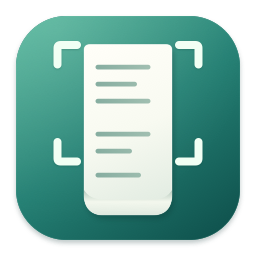

<p align="center">
  
</p>

<h1 align="center">LongCapture</h1>

<p align="center">Select an area. Scroll. Get one long image.</p>
<p align="center">A native macOS menu bar app for manually scrolling screenshots.</p>
<p align="center"><a href="README.md">简体中文</a> · <strong>English</strong></p>

LongCapture is a focused, open-source scrolling screenshot tool built with Swift,
AppKit, and SwiftUI. It stays in the menu bar, captures a selected scrolling
region, and stitches only the content it can verify while you scroll manually.

> **Public beta: [v1.1.0-beta.3](https://github.com/gnawlrak/LongCapture/releases/tag/v1.1.0-beta.3)**
>
> The prebuilt ZIP is for Apple Silicon and is **not notarized by Apple**.
> macOS 14 is the deployment target, but macOS 14/15, Intel Macs, mixed-DPI
> multi-display setups, and every target application have not all been tested
> on physical hardware. See the release notes and known limitations before
> installing.

## Why LongCapture?

Scrolling screenshots are easy to make look right and hard to make correct.
LongCapture takes the conservative route:

- capture only complete frames from the selected region;
- estimate motion with Vision plus independent pixel checks;
- reject ambiguous repeated patterns instead of guessing;
- pause when overlap cannot be verified, then recover from content that was
  already confirmed;
- keep every output pixel at its original Retina resolution.

**Scope:** manual scrolling only. There is no auto-scroll, OCR, annotation,
recording, editor, cloud service, history library, or automatic updater.
Screenshot processing and saving stay on your Mac.

## Features

- **Two selection modes** - Use the adjustable mode to move or resize the
  selection and press Return, or the quick mode to start immediately on
  mouse-up. The quick mode does not replace the system's Command+Shift+4
  shortcut.
- **Automatic axis detection** - Scroll in either direction after selecting.
  LongCapture locks to the first reliably verified vertical or horizontal
  movement.
- **Safe reverse scrolling** - Looking back does not delete confirmed content
  or duplicate it in the output. Growth resumes only after moving beyond the
  confirmed boundary in the original direction.
- **Fixed table edges** - Stable headers, first columns, and matching opposite
  edges can be excluded from the motion estimate. The scrolling body still has
  to pass independent overlap and seam checks.
- **Parallax-aware matching** - Text that moves or fades independently of the
  page background can be tolerated when the remaining image provides enough
  stable, textured evidence.
- **Recovery instead of guessing** - When matching becomes unreliable, the
  toolbar shows the specific rejection reason and a reference frame. Scroll
  back into confirmed content to recover; unknown pixels are never invented.
- **Native result flow** - A thumbnail appears in the bottom-right corner after
  capture. Hover pauses the auto-save countdown, or click to open a zoomable
  native preview.
- **Original-pixel PNG output** - Saves timestamped PNG files without
  overwriting existing files or silently changing the clipboard.
- **Multi-page captures** - When one output reaches its configured limit, the
  capture continues into a new page with a verified overlap.
- **Segmented export** - Export shorter, overlapping PNGs without changing the
  original output.
- **Drag out and share** - Drag original-pixel PNG copies from the thumbnail or
  preview, or open the native macOS share menu.
- **System-native UI** - Uses native controls, SF Symbols, light/dark
  appearance, and native glass materials. macOS 26+ can use Liquid Glass;
  older systems use the supported native blur fallback.

## Quick Start

### Install the current beta

1. Download the ZIP from the
   [v1.1.0-beta.3 release](https://github.com/gnawlrak/LongCapture/releases/tag/v1.1.0-beta.3).
2. Unzip it and move `LongCapture.app` into `Applications`.
3. If an older copy is running, finish or discard pending captures and quit it
   from the menu bar before replacing the app.
4. Launch `LongCapture.app`. There is no normal main window; look for the
   dotted-rectangle icon in the menu bar.
5. Grant **Screen Recording** permission on first use. If macOS asks you to
   restart the app, quit it and open it again.

The release also includes `SHA256SUMS.txt`. Verify the downloaded archive with:

```sh
shasum -a 256 -c SHA256SUMS.txt
```

### Gatekeeper

The public beta is signed with an Apple Development certificate but is **not
notarized**. Gatekeeper may block the first launch or warn that Apple cannot
check the app.

Only continue if you trust the source:

1. Try to open the app once and dismiss the warning.
2. Open **System Settings > Privacy & Security**.
3. Find the LongCapture warning and choose **Open Anyway**.

Do not disable Gatekeeper globally. If macOS reports malware or provides no
open-anyway option, stop and investigate rather than treating every warning as
a normal unsigned-app prompt.

### Capture

1. Choose **Start Long Capture** (`Control+Option+S`) for adjustable mode, or
   **Quick Long Capture** (`Control+Option+Shift+S`) for release-to-start mode.
2. Drag around the scrolling content. Keep fixed sidebars, the scrollbar,
   inputs, and continuously moving regions outside the selection whenever
   possible.
3. In adjustable mode, move or resize the selection and press Return. In quick
   mode, releasing the mouse starts the capture immediately.
4. Scroll the original app manually. LongCapture detects the axis and locks the
   growth direction after it has reliable evidence.
5. Press either capture shortcut again, or click **Finish** in the floating
   toolbar. Escape cancels.
6. The result thumbnail appears in the bottom-right corner. It auto-saves after
   about five seconds; hover pauses the timer, or click to open the preview.

Default shortcuts can be changed independently in Settings. The two shortcuts
cannot be assigned the same combination. While recording a new shortcut, both
global hotkeys are temporarily suspended.

## Result Workflow

- A single capture is saved as one PNG.
- A multi-page capture is saved into a new timestamped folder and named
  `-001.png`, `-002.png`, and so on.
- The preview supports zooming, scrolling, copying the current page, saving,
  sharing, segmented export, and discarding.
- **Normal close or Save keeps the result. Discard explicitly does not save.**
- Copy, drag, and share operate on the current page. Save and normal close
  operate on the whole result set.
- If saving fails, the result remains available for retry or for choosing a
  different folder.
- Existing files are never overwritten; name collisions receive a numeric
  suffix.

When a multi-page capture reaches the per-page limit of **64,000,000 pixels or
50,000 pixels along the scrolling axis**, whichever comes first, it starts a new
page with a verified overlap. A disk-write failure stops growth safely and
preserves the pages and crossing content already confirmed.

## Requirements and Status

| Item | Requirement / status |
| --- | --- |
| Runtime | macOS 14 or newer |
| Build tools | Xcode 27 or newer with the macOS 27 SDK |
| Verified development environment | Apple Silicon, macOS 27.2, Xcode 27.2 |
| Prebuilt architecture | arm64 only; not a Universal binary |
| Signing | Apple Development certificate; not notarized |
| Updates | No automatic updater |

macOS 14/15, Intel Macs, and real multi-display configurations remain
unverified. A deployment target or a passing unit test is not a claim that
every OS version, application, or display arrangement has been tested.

## How Matching Works

LongCapture uses ScreenCaptureKit to receive complete frames from the selected
display region and Vision to propose motion. Vision is never trusted by itself.
The candidate must also pass:

- texture sufficiency checks;
- overlap checks against the last confirmed pixels;
- seam validation;
- ambiguity checks for repeated patterns;
- axis and direction consistency checks.

The app accumulates small movements instead of dropping 1-3 pixel changes.
When a local lazy-loaded strip or animated region changes, the matcher can
exclude a bounded changed edge only after the primary estimate is classified as
unreliable. A duplicate-pattern ambiguity is never allowed to take that
fallback.

If the evidence is insufficient, capture pauses instead of skipping unknown
content. The toolbar identifies the rejection reason, and the current result
can still be finished and saved as an explicitly incomplete capture.

## Permissions and Privacy

- The only requested privacy permission is **Screen Recording**.
- LongCapture does not request Accessibility, Input Monitoring, microphone, or
  network access.
- No screenshots, telemetry, account data, or capture history are uploaded.
- The capture stream excludes the app's own interface, the mouse pointer, and
  audio.
- Pixel work runs on a background serial pipeline with at most one latest
  pending frame.
- Sealed pages from long multi-page captures use a private temporary directory
  (`0700`) with private image files (`0600`). Normal save, discard, or cancel
  cleans them up; forced termination or power loss is not crash-recoverable.

If Screen Recording appears enabled but LongCapture says it is unauthorized,
open the menu-bar permission panel and check the exact app path. macOS grants
permission to a signed app identity, not merely to a matching display name.
Remove stale Debug, Release, or relocated copies from System Settings, add the
current app, and relaunch it.

## Known Limitations

- Only one scrolling region on one display is supported. Cross-display
  selections and mixed horizontal+vertical stitching in one session are not.
- Only stable fixed edges are handled. Arbitrary internal sticky elements,
  floating controls, videos, and continuous animation may still cause a safe
  pause.
- Completely flat regions, isolated marks, genuinely repeated patterns, or a
  fast scroll with no verified overlap may be impossible to locate.
- A page-wide reflow, feed virtualization, advertisement replacement, or other
  wholesale content change can exceed the safe evidence boundary. LongCapture
  pauses rather than silently skipping or duplicating pixels.
- Flexible layout games, videos, zoom animations, and large transitions may
  require a manual retry after the content settles.
- Finder and chat-app file-promise drag-and-drop, as well as actual share
  delivery, still require broader manual testing.
- There is no editor, OCR, auto-scroll, cloud sync, history library, crash
  recovery, notarization, or automatic update.

## Build from Source

```sh
git clone https://github.com/gnawlrak/LongCapture.git
cd LongCapture
```

### Xcode

Open `LongCapture.xcodeproj`, select the shared `LongCapture` scheme, and choose
your own development team for both the app and test targets.

The repository contains the maintainer's team configuration for local
convenience. It does **not** contain certificates or private keys. Replace the
team before building or distributing a fork. Debug and Release use different
bundle identifiers so their Screen Recording permissions do not collide.

### Command Line

Ensure `xcode-select -p` points to a full Xcode installation and that this Mac
has a valid Apple Development certificate:

```sh
./scripts/build.sh DEVELOPMENT_TEAM=YOUR_TEAM_ID
open build/Release/LongCapture.app
```

Replace `YOUR_TEAM_ID` with your own team. The script produces a Release app for
the current machine architecture and verifies its signature and icon. It fails
instead of silently falling back to an ad-hoc signature.

## Testing

Core tests do not require an app-signing certificate:

```sh
swift test
swift test -c release
```

The hosted app and XCTest suite require a valid signing configuration:

```sh
./scripts/test.sh DEVELOPMENT_TEAM=YOUR_TEAM_ID

# Faster optimized compile for large pixel regressions; still a Debug bundle.
./scripts/test.sh DEVELOPMENT_TEAM=YOUR_TEAM_ID SWIFT_OPTIMIZATION_LEVEL=-O
```

The current suite contains **119 core SwiftPM tests and 194 hosted XCTest
cases**. It covers real Vision and injected motion, complete output pixel
ordering, both axes, fixed table edges, sparse content, lazy-loaded strips,
localized animation, slow and reverse scrolling, recovery, multi-page output,
segmented export, permissions, lifecycle, native UI, and result transfer.

Generate local, non-sensitive fixtures with:

```sh
python3 scripts/make-fixtures.py
open -a Safari build/Fixtures/LongCapture-test.html
open -a TextEdit build/Fixtures/LongCapture-test.txt
open -a Safari build/Fixtures/LongCapture-horizontal-test.html
```

These fixtures are generated locally and do not load network content.

## Project Structure

```text
LongCapture/Source/
  App/        Menu-bar entry, shortcuts, login item
  Capture/    ScreenCaptureKit, permission checks, coordinate conversion
  Core/       Motion estimation, overlap checks, stitching, sessions, saving
  UI/         Selection, toolbar, thumbnail, preview, settings, native glass
LongCapture/Tests/
scripts/
docs/
```

Design and acceptance documents are currently maintained in Chinese:

- [Architecture and core invariants](docs/ARCHITECTURE.md)
- [Verification record](docs/ACCEPTANCE.md)
- [Development log](docs/DEVLOG.md)

## Contributing

Issues and pull requests are welcome. When reporting a matching problem,
include:

- macOS version, LongCapture version or commit;
- target application;
- scroll direction and approximate selection size;
- display scale and whether multiple displays are involved;
- reproducible, non-sensitive fixtures or steps.

Do not upload private chats, credentials, or personal screen content. Changes to
stitching logic should include a pixel-level regression test. Do not hide a
reproduction by weakening validation thresholds or silently skipping content.

## License and Attribution

LongCapture, including the original source and icon artwork, is available under
the [MIT License](LICENSE). Keep the copyright and permission notice when
redistributing the software or a substantial portion of it.

The Vision registration, display-local coordinate, and session tail-frame
approach was informed in part by a pinned revision of
[ScrollSnap](https://github.com/Brkgng/ScrollSnap/tree/5be0a28f679358be658d4139d16465307f906c87).
LongCapture does not reuse its reverse-scroll crop logic or complete product
structure. The original MIT notice is preserved in
[THIRD_PARTY_NOTICES.md](THIRD_PARTY_NOTICES.md) and is bundled with the built
app.
