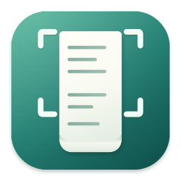

<p align="center">
  
</p>

<h1 align="center">长截图 · LongCapture</h1>

<p align="center">框选，滚动，得到一张长图。</p>
<p align="center">A native macOS menu bar app for manually scrolling screenshots.</p>

长截图是用 Swift、AppKit 和 SwiftUI 开发的 macOS 原生长截图工具。常驻菜单栏，框选应用中的正文区域后，由你手动滚动，软件将可靠重叠的内容拼成长图。

> 当前源码已加入横纵方向自动识别、横向截图、恢复参考图、分段导出与自动续张；已发布的 v1.0.0 安装包尚不包含这些新增功能。

**只专注长截图。** 没有自动滚动、OCR、标注、录屏文件、云服务、历史图库或第三方运行时依赖。截图处理与保存全部在本机完成，不上传屏幕内容。

## 特性

- **框选后直接滚动**：支持移动、调整选区；采集边框穿透鼠标，不妨碍操作原应用。
- **自动识别方向**：框选后直接滚动，可靠匹配后自动锁定横向或纵向，无需手动切换。反向回看不会删掉或重复加入已有内容。
- **可靠优先**：Vision 多区域位移估计结合像素重叠、纹理、歧义与接缝校验；无法确认时提示恢复，不猜测漏掉的内容。
- **表格固定边缘**：自动识别纵向固定表头、横向固定首列等边缘栏，使用滚动正文匹配，每张图仅保留一次，不在内部反复拼入。
- **局部视差文字**：画廊文字与底图不同步移动时，可用其余稳定底图确认位移，并寻找不切断文字的接缝；不是通用动画消除。
- **原生结果交互**：右下角缩略图悬停暂停自动保存，点击展开可缩放、滚动的预览，支持复制、保存和丢弃。
- **拖出与系统分享**：从缩略图或预览图像拖出原始像素 PNG 副本；预览顶部的「分享」打开 macOS 原生分享菜单，不替代原图保存。
- **匹配恢复引导**：暂停时显示最后可靠画面的参考图；回到当前张已确认的内容后可重新定位，不必精确退回最后一帧。区分反向回看、画面未新增和已恢复；接近单张上限时给出提示。
- **自动续张**：达到单张上限后自动接到下一张，保留重叠与原增长方向；结束后按阅读顺序预览、整组保存。
- **分段分享**：预览中可另存有重叠的短图，自定义像素长度与重叠；不替代原始长图。
- **原始像素 PNG**：保留 Retina 分辨率与 sRGB；时间戳命名、同名自动递增，不覆盖已有文件，不自动改剪贴板。
- **系统级体验**：可配置全局快捷键、保存目录和登录时启动；macOS 26+ 使用原生 Liquid Glass，旧系统使用原生毛玻璃，并适配减少透明度。

## 系统要求与当前状态

| 项目 | 要求 / 状态 |
| --- | --- |
| 运行目标 | macOS 14 或更新版本 |
| 构建工具 | Xcode 27 或更新版本，macOS 27 SDK |
| 已验证开发环境 | Apple Silicon、macOS 27.2、Xcode 27.1 |
| 架构 | 构建脚本默认生成当前机器架构，非 Universal 包 |
| 签名 | 本地 App 构建流程要求自己的 Apple Development 签名证书 |
| 分发 | 尚未公证，不含自动更新 |

macOS 14/15 是兼容性部署目标，尚未在对应真机系统完成验收；Intel Mac 与真实多显示器环境也尚未实测。请勿将部署目标或单元测试通过理解为所有系统、应用均已验证。

作者已在 Codex 和其他日常应用中进行实际使用，暂未报告问题；这不是覆盖全部场景的兼容性保证。详细自动化验证、已知边界和待验证项目见 [验收记录](docs/ACCEPTANCE.md)。

## 快速使用

1. 启动 App，点击菜单栏的虚线矩形图标，或按默认快捷键 **⌃⌥S**（Control + Option + S）。应用没有空白主窗口。
2. 首次使用允许**屏幕录制**权限；如果系统提示需要重启 App，请退出后重新打开。
3. 从**开始长截图**或快捷键进入，拖动框选**正文滚动区域**，拖动内部移动、边缘调整，按 **Return** 开始，**Esc** 取消。横向、纵向统一**自动识别**，无需选择方向。可包含紧贴滚动方向边缘的固定表头或首列，仍应避开无关侧栏、输入框、滚动条与动画，并给滚动正文留足空间。
4. 在原应用中直接滚动。工具条先显示自动识别，确认可靠位移后锁定横向或纵向及增长方向，随后显示当前张数和长度；反向回看和自动续张不改变已锁定的轴。一次采集中不能混合横纵滚动。
5. 点击工具条的**完成**，或再次按快捷键结束；取消则放弃本次采集。
6. 右下角出现结果缩略图，约 **5 秒**后自动保存。悬停暂停计时，移开继续；点击立即打开预览。

预览支持缩放、滚动、复制、保存和丢弃，没有编辑器。**完成或普通关闭会保存；明确丢弃不会保存。** 保存失败时保留结果，可重试或选择其他目录；未处理的结果会阻止下一次截图，避免覆盖。

横向预览默认适合高度并可左右滚动，纵向默认适合宽度。多张结果使用顶部的分页菜单切换，**复制只复制当前一张，保存/完成/普通关闭会保存整组**。单张仍保存为一个 PNG；续张结果保存到时间戳命名的新文件夹，图片以 `-001.png`、`-002.png` 编号。向上采集按从上到下排列，向左采集按从左到右排列。

**直接拖出**：按住缩略图或预览中的图像并拖动，可交给支持图片或文件拖放的接收端。缩略图拖出首张，预览拖出当前张；多张请切换后逐张操作。拖动中倒计时暂停，取消或结束后按剩余时间和悬停状态继续，原结果不会因拖出而丢弃。文件承诺使用 PNG、后台写盘且不覆盖已有文件；大图首次拖出可能需要编码时间。

**系统分享**：预览顶部 → **分享**，发送当前张的图片副本，来源保持原始像素，不把预览缩放当成导出尺寸。具体目标和接收后的格式由系统及接收应用决定。取消分享不影响结果；原图仍需保存或明确丢弃。拖出或分享都不自动修改通用剪贴板。

自动识别只使用现有截图帧，不读取滚轮事件或申请新权限。初始 1–3 像素微动先累计，不立即因抖动锁轴；到 4 像素且只有一个方向通过匹配、重叠与接缝校验时锁定。若只滚了少量就结束，仍尝试保留已可靠匹配的微小尾段。斜向移动、两个方向都有歧义或没有可靠重叠时提示回滚恢复，不猜测方向；完全未滚动可保存起始画面。

### 表格固定行与列

纵向滚动时位于顶部的固定表头、横向滚动时位于左侧的固定首列，以及对应的底部／右侧固定栏，可自动从匹配证据中排除。软件仍需确认滚动正文的重叠与接缝；固定栏不能单独证明发生了位移。原始像素不会因识别而裁掉，每张长图在相应外边缘保留一次固定栏，反向回看、恢复和自动续张沿用同一规则。

这不是任意表格重建：只处理紧贴选区边缘、横跨选区另一维度的稳定条带，不支持一张图内混合横纵滚动、任意内部固定块、自动展开或补出从未显示的单元格。固定栏占比过大、正文重叠过短或单元格完全重复时仍可能暂停；可缩小固定部分、扩大正文选区并减小每次滚动幅度。

### 分段导出

在预览中点击**分段导出…**，设置分段长度（默认 2,400 像素）和相邻重叠（默认 120 像素）。纵向按高度切，横向按宽度切，不缩放原始像素。长度范围 256–20,000，重叠不超过长度的一半，避免误设成每次只前进一个像素。

所有短图另存到当前保存目录下一个新的“时间戳-分段”文件夹；多张结果按“原始张号-分段号”编号。**导出不关闭预览，也不替代原始长图**；之后仍可保存或丢弃原图，明确导出的副本不因丢弃原图而删除。导出失败保留原图，可更改保存位置重试，不留下部分发布的文件夹。导出期间禁止保存/丢弃/关闭或退出，避免结果被提前释放。

默认保存到桌面。菜单栏 → **设置**可修改保存目录、快捷键和**登录时启动**。登录启动只在菜单栏待命，不自动截图或申请权限；它绑定当前 App 路径，建议先确定安装位置再开启。

### 画廊视差与动画

部分网页（例如 [Apple OS 概览](https://www.apple.com.cn/os/) 顶部横向画廊）的标题会额外平移、淡入淡出，不能把它与底图当作同一个刚性画面。软件允许在独立像素验证后，以大范围稳定、有纹理的底图确认位移；接缝仍检查全部区域，尽量把整块文字留在可替换的当前视口中，而不是逐条切碎。横向与纵向共用这套规则。

大面积白底中的细窄卡片分隔线会额外做跨区域、多尺度采样，避免规则网格漏掉边界后，被无纹理的短片段误报为滚动歧义。只有已通过近乎无损重叠验证的较大匹配，才能排除没有相应刚性边界证据的较短候选；重复分隔线仍不能强拼。保留网页吸附与动画的连续屏幕采集测试已在该画廊正反方向完整结束，但过程中仍有短暂停顿后恢复，不承诺无暂停或还原动画文字的全不透明状态。

这不保证将网页所有动画定格为同一时刻：文字可能保留采集时的淡化状态。整幅图缩放、视频、大面积转场、横跨所有可用接缝的动态内容，或者底图缺乏唯一纹理时仍会暂停；请等画面稳定后恢复。不从网页 DOM 取图、不自动修改网页，也不需要额外权限。

大面积纯色中分散的小字或图标另有稀疏特征校验：需要多个跨区域特征的像素块全部吻合，并通过独立重叠与歧义检查。历史恢复索引也会采样这些特征，而不只依靠等间隔列。完全纯色、只有孤立标记或真正重复的内容仍不能确定距离，不会按滚动速度猜测或补出未确认像素。

### 遇到“匹配暂停，请往回滚动恢复”

这表示当前画面无法与最后确认的画面可靠衔接。缓慢往回滚到**当前张已截过的内容**；只要整个选区能在已确认部分唯一定位，并通过完整视口的像素、纹理与配准检查，即可恢复，不必精确退回最后一帧。恢复只重设当前位置，不删除已有内容或加入未知像素；继续沿原方向超出已截边界后才增长。

如果仍无法恢复，参考工具条展开的**最后确认画面**回滚到附近，再减小每次滚动幅度继续。恢复后会提示“已恢复匹配”；反向回看会单独提示，不代表正在增长。重新定位仅搜索当前活跃的一张，不从此前已封存的续张中自动查找；重复图案存在多个可能位置时不会猜测。原因提示只报告已知的尺寸、重叠或接缝校验问题，不要求回滚某个未经确认的像素距离。

相似列表配合大幅滚动、完全重复图案、无重叠快滚、动态内容或移动/缩放原窗口都可能触发暂停。此时直接完成，只导出已确认的部分，并提示结果不完整；软件不会静默跳过未确认的内容。

## 从源码构建

```sh
git clone https://github.com/gnawlrak/LongCapture.git
cd LongCapture
```

### 方式一：Xcode

打开 `LongCapture.xcodeproj`，选择共享的 `LongCapture` scheme。在 App 与测试目标的 **Signing & Capabilities** 中选择自己的开发团队，再构建运行。

工程当前保留维护者的本机团队配置，**仓库不包含签名证书或私钥**；其他开发者必须替换团队，不能直接使用维护者的签名身份。

Debug 显示为“长截图（调试）”，标识为 `com.gnawlrak.LongCapture.debug`；Release 为“长截图”，标识为 `com.gnawlrak.LongCapture`。两者分别获得屏幕录制权限。自行分发衍生版本时，请同时更换自己的 Bundle Identifier。

### 方式二：命令行

确认 `xcode-select -p` 指向完整 Xcode，并已在本机配置有效的 Apple Development 证书：

```sh
./scripts/build.sh DEVELOPMENT_TEAM=YOUR_TEAM_ID
open build/Release/LongCapture.app
```

将 `YOUR_TEAM_ID` 替换为自己的团队 ID。脚本生成当前机器架构的 Release App，并检查签名与图标；没有有效证书时会失败，不会静默降级为临时签名。不要提交证书、私钥或包含凭据的本机配置。

**只运行核心测试无需 App 签名证书**，见下方测试章节。当前 App 脚本不是免证书安装流程。

### 关于未公证分发

开源不要求 Apple 公证，但从网络下载的未公证 App 可能被 macOS Gatekeeper 拦截。当前仓库不承诺免警告安装，也不提供商店上架或 Developer ID 公证流程。源码构建与下载预编译 App 的权限、信任体验不同；不要为运行应用而全局关闭系统安全机制。

## 权限与隐私

- 唯一主动申请的隐私权限是**屏幕录制**，用于读取选区画面；不申请辅助功能、输入监控或麦克风权限。
- 不包含网络请求、截图上传、遥测或账号系统。快捷键使用 Carbon 系统热键，不是全局键盘监听。
- 屏幕流排除本应用界面、鼠标指针和音频；像素处理位于后台串行队列，最多保留一个最新待处理帧。
- 保存到桌面或文稿时，macOS 可能额外询问文件夹访问权限。保存失败不会丢弃截图。
- 活跃拼接保留在内存；为避免总长度导致内存持续增长，**已封存的续张会写入私有临时目录**（目录 0700、图片 0600）。正常保存/丢弃/取消会清理；分段导出后仍保留原图以供继续处理。强制结束或断电不能保证恢复或即时清理临时内容，当前不提供崩溃恢复或历史图库。

### 权限已开启，仍显示未授权？

菜单栏 → **屏幕录制权限…**，或设置 → 权限，可查看当前 App 的名称、标识、路径，并申请权限、打开系统设置或检查状态。打开 App、检查状态本身不会弹出权限请求。

macOS 的授权与应用身份、签名有关，不只看同名开关。请确认授权的是权限页所显示路径下的当前 App，而不是旧构建或另一个 Debug/Release 版本。必要时在系统设置 → 隐私与安全性 → 屏幕录制（新版为“屏幕与系统录音录制”）移除旧条目，添加当前 App，再退出重开。

重新构建时更换团队、证书、Bundle ID，或使用临时签名，都可能影响既有授权。应用不会自行修改或重置系统权限记录。

## 已知边界

- 仅支持**单个显示器内的单个纵向或横向滚动区域**，不支持跨屏选框或同一会话的二维混合拼接。
- 支持滚动方向边缘的稳定固定行／列，但不承诺自动消除任意内部固定控件、悬浮按钮、视频或持续动画；从未被可靠画面展示的像素无法补出。
- 完全相同的周期画面与静止在视觉上无法区分，软件会保守地不增长，而不是猜测位移。
- 每张上限为 **64,000,000 像素或沿滚动轴 50,000 像素长度**，先到者为准；达到后自动续张，不重新匹配起点或改变增长方向。张间重叠保留跨界视口的可靠内容（最多一个视口），不静默丢弃溢出像素。结束时不会输出一张完全重复的空续张。
- 自动续张不等于无限资源：磁盘写入失败会停止增长、保留内存中的跨界内容和此前各张，标记不完整；若单个初始视口本身已达到单张上限，则保留上限内的部分并提示缩小选区。
- 锁屏、睡眠、显示器变化或采集流中断会安全结束，保留已确认部分；真实硬件中断场景仍需更多实测。
- 没有自动滚动、编辑器、OCR、云同步、历史图库、公证或自动更新。

## 测试与开发

```sh
# 核心测试：不需要 App 签名证书
swift test
swift test -c release

# 完整 App / XCTest：需要自己的签名配置
./scripts/test.sh DEVELOPMENT_TEAM=YOUR_TEAM_ID

# 大幅像素回归的 Debug 运行较慢，可优化编译；仍使用独立调试版身份
./scripts/test.sh DEVELOPMENT_TEAM=YOUR_TEAM_ID SWIFT_OPTIMIZATION_LEVEL=-O

# 构建 Release 后验证签名身份稳定性
./scripts/test-signing.sh
```

当前包含 **113 项核心测试、168 项完整 XCTest**。覆盖真实 Vision 与注入位移的逐像素拼接、横纵方向自动识别/锁轴/斜滑拒绝/微动尾帧、独立绘制的正向横排文字及 64–95px 高短选区、连续色彩图像/多尺度纹理/低对比邻近位移的区分、Retina 独立颜色量化、固定表头/首列/双边栏的匹配与恢复及过小正文拒绝、局部视差画廊的完整文字/稳定底图像素及不可用接缝拒绝、上下/左右滚动和反向回看、慢滚/亚像素累计、恢复参考图、当前张内重新定位/歧义拒绝/恢复后继续增长、双向续张的溢出/重叠/阅读顺序、临时写入失败与清理、分段像素顺序与整组原子保存、最新帧背压、结束尾帧、取消迟到回调、权限、PNG 拖出/分享的原始像素与结果生命周期，以及原有结果流程。真实接收端的拖放兼容性仍需人工验收，不以单元测试代替。

登录项和权限状态测试主要使用注入适配器，不会为了测试自动注册本机登录项或改动系统授权。合成帧、离屏渲染和单元测试不代替真实应用及硬件验收。

可生成本地非敏感测试素材：

```sh
python3 scripts/make-fixtures.py
open -a Safari build/Fixtures/LongCapture-test.html
open -a TextEdit build/Fixtures/LongCapture-test.txt
# 横向测试页：保持自动模式，在网页上左右滚动
open -a Safari build/Fixtures/LongCapture-horizontal-test.html
```

素材全为本地生成，不加载网络。图标由 Swift / Core Graphics 绘制，源稿可重新生成；界面样张只使用自建窗口与生成背景：

```sh
swift scripts/render-app-icon.swift
swift scripts/test-app-icon.swift
./scripts/render-ui.sh
# 可选：已有屏幕录制权限时检查系统合成效果，不主动申请权限
./scripts/render-ui.sh --composited
```

构建产物、测试日志和样张均位于被 Git 忽略的 `build/`，SwiftPM 产物位于 `.build/`。

### 项目结构

```text
LongCapture/Source/
  App/        菜单栏入口、快捷键、登录项
  Capture/    屏幕录制权限、ScreenCaptureKit、坐标转换
  Core/       位移估计、重叠校验、拼接/续张状态、会话、私有暂存与结果保存
  UI/         选区、工具条、缩略图、预览、设置、系统玻璃材质
LongCapture/Tests/
scripts/
docs/
```

- [架构与核心不变量](docs/ARCHITECTURE.md)
- [验证记录与人工验收清单](docs/ACCEPTANCE.md)
- [开发记录](docs/DEVLOG.md)

## 反馈与贡献

欢迎提交 [Issue](https://github.com/gnawlrak/LongCapture/issues) 或 Pull Request。反馈匹配问题时，请附上 macOS 版本、App 版本或提交号、目标应用、滚动方向、选区尺寸与显示缩放，以及可复现步骤。

请优先使用仓库生成的测试文档或其他非敏感素材，**不要上传聊天记录、账号信息或私人屏幕内容**。修复拼接逻辑时，请增加逐像素回归测试；不要通过放宽校验阈值、静默跳过内容来掩盖失败。提交前运行相关测试，并说明尚未验证的行为。

## 许可与致谢

本项目（含原创代码与图标源稿）使用 [MIT License](LICENSE)。允许使用、修改、分发与商用，须保留版权与许可声明；软件按原样提供，不附带保证。

有限借鉴 [ScrollSnap 固定提交](https://github.com/Brkgng/ScrollSnap/tree/5be0a28f679358be658d4139d16465307f906c87) 的 Vision 配准、显示器局部坐标与会话尾帧调度思路；不沿用其反向滚动裁图或完整产品结构。原作者 Berker Gungor 的 MIT 声明保存在 [第三方许可](THIRD_PARTY_NOTICES.md)。项目许可和第三方声明均随构建后的 App 一起打包。
